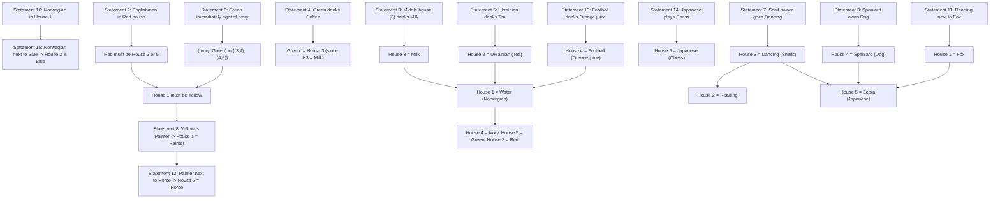

# Zebra Puzzle: Maintenance Guide and Specification Analysis

## Overview

This maintenance document records the specification analysis, constraint deduction, and verification harness for the `zebra-puzzle` practice exercise in the Exercism Java track for Task R58-T010. It establishes why the expected outcomes follow strictly from the 15 specification statements, articulates a complete decision table matching the JUnit 5 test suite, separates specified behavior from inputs outside the exercise contract, and documents the isolated reference runner.

---

## Problem Contract & Domain Model

The Zebra Puzzle is a logic constraint satisfaction problem. Five contiguous houses (numbered 1 through 5 from left to right) each possess unique attributes across five distinct domains:
1. **House Position**: $1$ (first/leftmost), $2$, $3$ (middle), $4$, $5$ (rightmost)
2. **Color**: Red, Green, Ivory, Yellow, Blue
3. **Inhabitant Nationality**: Englishman, Spaniard, Ukrainian, Japanese, Norwegian
4. **Beverage**: Coffee, Tea, Milk, Orange juice, Water
5. **Pet**: Dog, Snails, Fox, Horse, Zebra
6. **Hobby**: Dancing, Painter, Reading, Football, Chess

The Java exercise defines the following public interface contract on class `ZebraPuzzle`:
- `String getWaterDrinker()`: Returns the nationality of the resident who drinks water.
- `String getZebraOwner()`: Returns the nationality of the resident who owns the zebra.

Both methods are parameterless getters returning standard Java `String` values.

---

## Test Suite & Canonical Case Analysis

The test suite in `exercises/practice/zebra-puzzle/src/test/java/ZebraPuzzleTest.java` is derived directly from `.meta/tests.toml`:

| Canonical UUID | Test Method | `@DisplayName` | Input / Query | Expected Result | In Learner Stub |
|---|---|---|---|---|---|
| `16efb4e4-8ad7-4d5e-ba96-e5537b66fd42` | `residentWhoDrinksWater` | `resident who drinks water` | `getWaterDrinker()` | `"Norwegian"` | Enabled (`@Test`) |
| `084d5b8b-24e2-40e6-b008-c800da8cd257` | `residentWhoOwnsZebra` | `resident who owns zebra` | `getZebraOwner()` | `"Japanese"` | Disabled (`@Disabled`) |

In the learner starter repository, the second test method is annotated with `@Disabled("Remove to run test")` to support incremental test-driven development. The reference verification runner un-disables this annotation exclusively in a temporary scratch copy, validating that both canonical cases pass against the maintained reference implementation.

---

## Step-by-Step Constraint Deduction

The 15 statements from `instructions.md` are evaluated deductively to reach the unique solution:



### Complete Assignment Matrix

| House Position | 1 (First) | 2 | 3 (Middle) | 4 | 5 (Fifth) |
|---|---|---|---|---|---|
| **Color** | Yellow | Blue | Red | Ivory | Green |
| **Inhabitant** | Norwegian | Ukrainian | Englishman | Spaniard | Japanese |
| **Beverage** | **Water** | Tea | Milk | Orange juice | Coffee |
| **Pet** | Fox | Horse | Snails | Dog | **Zebra** |
| **Hobby** | Painter | Reading | Dancing | Football | Chess |

---

## Decision Table

The decision table below links each test case and input query directly to its expected outcome and the specific constraints governing the deduction:

| Test Case | Query Invocation | Input Condition & Specification Constraints | Required Outcome | Verification Rationale |
|---|---|---|---|---|
| `resident who drinks water` | `zebraPuzzle.getWaterDrinker()` | Statements 1, 4, 5, 8, 9, 10, 13, 15: Norwegian fixed in House 1, Blue in House 2, Milk in House 3. Yellow/Painter in House 1. Ukrainian/Tea in House 2. Football/Orange juice in House 4. Green/Coffee in House 5. Only Water remains for House 1. | `"Norwegian"` | The Norwegian in House 1 is uniquely deduced as the water drinker without violating any beverage or hobby constraints. |
| `resident who owns zebra` | `zebraPuzzle.getZebraOwner()` | Statements 1–15: Full propagation resolves Houses 1–4 pets as Fox (H1), Horse (H2), Snails (H3), Dog (H4). House 5 is Green/Coffee/Japanese/Chess. Only Zebra remains for House 5. | `"Japanese"` | The Japanese resident in House 5 is the sole inhabitant who can own the zebra under the complete constraint set. |

---

## Specified Behavior vs. Unspecified Contract Boundary

To prevent overfitting, artificial coupling, and unwarranted contract extensions, maintainers and automated checks must respect the boundary between specified requirements and unspecified inputs:

| Aspect | Specified Contract | Outside Exercise Contract / Unspecified | Maintenance Policy |
|---|---|---|---|
| **Interface Methods** | `getWaterDrinker()`, `getZebraOwner()` | Queries for other pets, beverages, colors, or house numbers (e.g. `getFoxOwner()`, `getHouse(int)`) | Reject additions to public class signature. Keep interface minimal. |
| **Method Arguments** | Both methods accept no arguments (`void`) | Methods with arguments, constructors accepting custom statements | Do not introduce or test parameterized overloads. |
| **Configuration** | Fixed 5-house, 15-statement logic puzzle | Variable house counts ($N \ne 5$), custom or mutable statement sets | Treat puzzle parameters as compile-time constants. |
| **Exception Rules** | Methods execute normally without throwing checked or runtime exceptions | Argument exceptions, boundary exceptions, custom domain exceptions | Do not impose or require any exception-throwing behavior. |
| **String Coercion** | Exact case-sensitive string matching (`"Norwegian"`, `"Japanese"`) | Lowercasing, case-folding, whitespace trimming, enum types | Enforce strict string literal equality (`isEqualTo`). |
| **Call Ordering** | Independent, idempotent method invocations | Enforced call sequence, state mutation across calls | Ensure methods can be called in any order repeatedly. |
| **Algorithm** | Any valid logic solver (backtracking, permutations, hardcoded) | Specific search order or performance requirement | Maintain tests that assert outputs, not implementation mechanics. |

---

## Source Architecture & Generated Artifacts

| Path | Category | Role | Maintenance Status |
|---|---|---|---|
| `exercises/practice/zebra-puzzle/.meta/config.json` | Exercise Metadata | Defines author list, source URL, and file role mappings (`solution`, `test`, `example`, `invalidator`). | Maintained |
| `exercises/practice/zebra-puzzle/.meta/tests.toml` | Exercise Metadata | Canonical UUID mappings and case descriptions from Problem Specifications. | Maintained |
| `exercises/practice/zebra-puzzle/.meta/src/reference/java/ZebraPuzzle.java` | Reference Source | Permutation-based reference solver that explores house assignments and satisfies all 15 constraints. | Maintained |
| `exercises/practice/zebra-puzzle/src/test/java/ZebraPuzzleTest.java` | Test Suite | JUnit 5 canonical test suite with `@DisplayName` annotations. | Maintained |
| `exercises/practice/zebra-puzzle/src/main/java/ZebraPuzzle.java` | Learner Starter | Unsolved starter stub throwing `UnsupportedOperationException`. | Maintained (Must remain unsolved) |
| `exercises/practice/zebra-puzzle/.docs/hints.md` | Learner Guidance | Detailed CSP explanation, step-by-step deduction, decision table, and contract boundary statement. | Maintained |
| `build/` | Ephemeral Artifact | Gradle compilation and test output directory; excluded from version control. | Ignored |
| `.gradle/` | Ephemeral Artifact | Gradle build cache and daemon state; excluded from version control. | Ignored |

---

## Failure-Mode Verification Matrix

The automated verification suite (`work/R58-T010/check.py`) exercises the reference runner under multiple controlled scenarios:

| Scenario | Subprocess Command | Expected Outcome | Actual Result | Verification Status |
|---|---|---|---|---|
| **Maintained Reference** | `./gradlew test --no-daemon` (with reference in scratch `src/main/java`) | Exit 0; 2 executed, 2 passed, 0 failures, 0 errors, 0 skipped | Exit 0; 2 executed, 2 passed | **PASSED** |
| **Contract Probe** | `java ZebraPuzzleContractProbe` | Exit 0; passes water, zebra, order-independence, and idempotence checks | Exit 0; 5 probe checks passed | **PASSED** |
| **Deliberate Mutant** | `./gradlew test --no-daemon` (mutant returning `"Englishman"` for water) | Exit 1; failures > 0, child exit non-zero | Exit 1; 1 failure, 0 errors | **REJECTED AS EXPECTED** |
| **Empty Test Selection** | `./gradlew test --no-daemon --tests NoSuchZebraTestClass` | Exit 1; 0 executed tests, child exit non-zero | Exit 1; 0 executed tests | **REJECTED AS EXPECTED** |

---

## Verification Commands

To execute the automated verification suite from the repository root:

```bash
# 1. Focused course check entry point:
python3 tools/course_checks/r58-t010.py

# 2. Complete verification check:
python3 work/R58-T010/check.py
```
